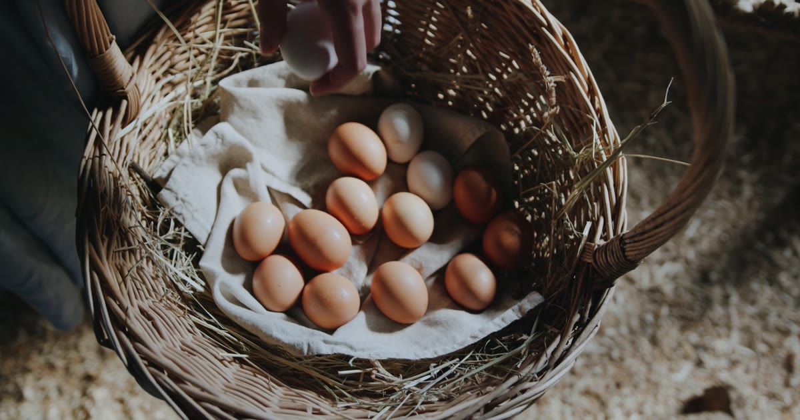

# El Agropecuario · Landing



Landing de **El Agropecuario**, distribuidora de huevos y pollos: pollo campesino de piel amarilla natural y huevos colorados, a domicilio. Los pedidos se hacen por WhatsApp.

La portada es un **paseo por la finca que avanza y retrocede con el scroll**: seis tramos de vídeo, de la granja y los huevos recién recogidos hasta los pollitos al aire libre. Debajo están los productos, los combos, las preguntas frecuentes, el pedido semanal y la llamada final para pedir.

**Stack:** [Astro 7](https://astro.build) · [Tailwind CSS 4](https://tailwindcss.com) · [GSAP ScrollTrigger](https://gsap.com/docs/v3/Plugins/ScrollTrigger/) · [Lenis](https://lenis.darkroom.engineering) · sharp

## Puesta en marcha

Necesitas Node.js 22.12 o superior y pnpm.

```sh
pnpm install
pnpm dev
```

La web queda en `http://localhost:4321`.

| Comando | Qué hace |
| :-- | :-- |
| `pnpm dev` | Servidor de desarrollo con las marcas de contenido pendiente visibles |
| `pnpm build` | Genera la web estática en `dist/` |
| `pnpm preview` | Sirve el build en local para revisarlo antes de publicar |

## Cómo funciona el paseo

- **Seis paradas, seis tramos.** Cada parada de `paseo.paradas` (en `src/features/landing/domain/finca.ts`) tiene su clip, que va de ella a la siguiente: la granja, el nacimiento, los pollitos, la crianza, la recogida y al aire libre. Los seis clips salen de un solo vídeo de 8 s partido en tramos iguales, así que cada uno termina donde empieza el siguiente.
- **El scroll manda.** `world.ts` traduce la posición del scroll a un valor continuo y fija el `currentTime` del clip activo. El vídeo solo avanza cuando haces scroll.
- **Los pósters tapan la carga.** Bajo cada vídeo está su primer fotograma. Mientras el clip no ha cargado se ve el póster, y el cambio no se nota.
- **Carga por cercanía.** Los clips se descargan de uno en uno, empezando por el tramo actual y siguiendo por el más cercano.
- **Móvil.** El 16:9 se recorta en vertical y el campo `focus` de cada parada decide qué parte queda a la vista.
- **Sin vídeo cuando no toca.** Con `prefers-reduced-motion` o con ahorro de datos activo solo se ven los pósters.

## Estructura

```text
src/
├── data/
│   ├── finca.ts          Todo el contenido: marca, paradas, productos, combos, FAQ, contacto y SEO
│   ├── schema.ts         JSON-LD: LocalBusiness con catálogo, WebSite, WebPage y FAQPage
│   └── imagenes.ts       Imagen para redes y fotos con URL fija (JSON-LD y sitemap)
├── pages/
│   ├── index.astro       Landing
│   ├── robots.txt.ts
│   ├── llms.txt.ts
│   └── 404.astro
├── layouts/Layout.astro  <head>: metas, Open Graph, Twitter Card y fuentes
├── components/
│   ├── ScrollWorld.astro Paseo por la finca: pósters, clips y textos de cada parada
│   ├── Dishes.astro      Productos (#productos)
│   ├── Experiences.astro Combos (#combos)
│   ├── Faq.astro         Preguntas frecuentes (#preguntas)
│   ├── Gift.astro        Pedido fijo cada semana (#semanal)
│   ├── FinalCta.astro    Llamada final a pedir (#pedir)
│   ├── Pending.astro     Marca de contenido pendiente (solo en desarrollo)
│   └── …                 Cabecera, pie, logo, iconos y adornos
├── scripts/
│   ├── motion.ts         Lenis, apariciones al hacer scroll y animaciones con GSAP
│   └── world.ts          Lógica del paseo: scrub, pósters y cola de carga
├── styles/global.css     Tokens de Tailwind y utilidades
└── assets/               Fotos, pósters del paseo y fuentes
public/
├── video/finca-1…6.mp4   Clips del paseo, codificados para scrub
├── photos/               Fotos en JPG con URL fija (JSON-LD y sitemap)
├── og-image.jpg          Imagen para redes (1200×630)
└── site.webmanifest      Manifest e iconos
```

## Editar el contenido

Casi todo el texto vive en `src/features/landing/domain/finca.ts`. El copy de las paradas del paseo está en `ScrollWorld.astro`.

- **Nombre de la marca:** se cambia en `marca` y se actualiza en toda la web (logo, títulos, SEO y JSON-LD).
- **WhatsApp:** el número va en `whatsapp`, con indicativo y sin espacios (`57…`). De él salen los enlaces de pedido y el teléfono.
- **Precios:** mientras un precio sea `'$ —'`, el JSON-LD publica la oferta sin precio.
- **Pendientes:** lo que no está confirmado se marca con `<Pending>` o con el campo `pending`. Solo se ve con `pnpm dev` y nunca llega al build.

## Cambiar un clip del paseo

Cada clip necesita un keyframe cada pocos fotogramas (`-g 6`) para que el scrub sea fluido, y el color marcado como BT.709 con curva sRGB para que coincida con el póster:

```sh
ffmpeg -i clip.mp4 -an -vf "scale=1920:-2" -c:v libx264 -preset slow -crf 28 \
  -g 6 -keyint_min 6 -sc_threshold 0 -pix_fmt yuv420p \
  -color_primaries bt709 -color_trc iec61966-2-1 -colorspace bt709 -color_range tv \
  -movflags +faststart+write_colr public/video/finca-1.mp4
```

Después regenera su póster con el primer fotograma, conviértelo a WebP y guárdalo en `src/assets/paseo/`:

```sh
ffmpeg -i public/video/finca-1.mp4 -frames:v 1 \
  -vf "scale=in_color_matrix=bt709:in_range=tv:out_range=pc,format=rgb24" finca-1.png
```

## SEO

- **Metas:** título y descripción en `seo` (`src/features/landing/domain/finca.ts`), Open Graph y Twitter Card con `og-image.jpg`. La 404 lleva `noindex`.
- **Datos estructurados:** `src/features/landing/domain/schema.ts` genera `LocalBusiness` (ubicación, contacto, catálogo de productos y combos, y pedido por WhatsApp), `WebSite`, `WebPage` y `FAQPage`.
- **Rastreo:** `@astrojs/sitemap` genera el sitemap con las fotos de la finca, y `robots.txt` lo enlaza.

## Pendiente

- Nombre definitivo de la marca.
- Número de WhatsApp, Instagram, ubicación, zona y días de entrega, y horario.
- Catálogo, combos y precios.
- Confirmar las respuestas marcadas como pendientes en las preguntas frecuentes.
- Fotos y vídeos de la finca real. Los actuales son provisionales de stock.

## Créditos

- Fotos y vídeos provisionales: [Pexels](https://www.pexels.com), con licencia libre.
- Fuentes: [Hina Mincho](https://fonts.google.com/specimen/Hina+Mincho) y [Zen Kaku Gothic New](https://fonts.google.com/specimen/Zen+Kaku+Gothic+New), bajo licencia SIL OFL. Se sirven desde el propio dominio.
